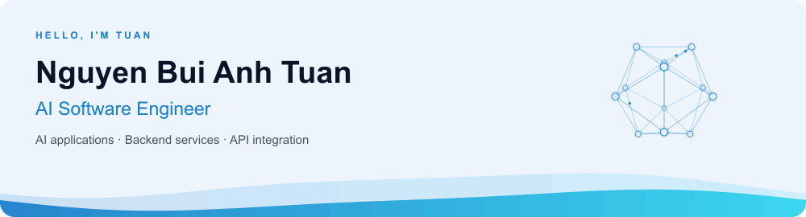
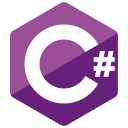
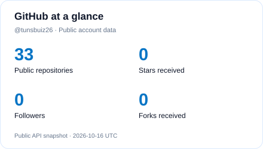
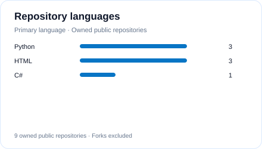

<picture>
  <source media="(prefers-reduced-motion: reduce) and (prefers-color-scheme: dark)" srcset="assets/header-dark.svg" />
  <source media="(prefers-reduced-motion: reduce)" srcset="assets/header-light.svg" />
  <source media="(prefers-color-scheme: dark)" srcset="assets/header-dark.gif" />
  
</picture>

  
  
  

## About me

I'm **Nguyen Bui Anh Tuan**, a developer based in **Hanoi, Vietnam**, focused on AI-powered applications and backend engineering. I enjoy connecting AI capabilities with practical workflows, reliable APIs, and clear user interfaces.

- **Currently:** AI Engineer at **VIN SMART FUTURE - KD&VH GSM**, contributing to driver coordination, API integration, approval workflows, and operational dashboards.
- **Focus:** Python, FastAPI, C#/.NET, prompt engineering, RAG, and AI agent integration.
- **Engineering practices:** Data contract design, error handling, business logic testing, database integration, and Git collaboration.
- **Looking for:** Opportunities as an **AI Software Engineer**.

## Tech stack

  
  
  
  
  
  
  
  
  
  
  
  
  

| Area | Technologies and practices |
| :--- | :--- |
| Languages | C#, Java, Python, JavaScript, SQL |
| Frameworks | .NET, ASP.NET, Entity Framework, Spring Boot, FastAPI, React |
| AI / LLM | Prompt Engineering, Retrieval-Augmented Generation (RAG) |
| Backend & APIs | REST APIs, data contracts, UI/API integration, error and missing-data handling |
| Databases | MySQL, SQL Server, PostgreSQL |
| Testing | Pytest, Vitest; business logic, API, and database integration testing |
| Tools & teamwork | Git, GitHub, Docker, Docker Compose; branching, merge conflict resolution, pull requests |

## Selected projects

### [VSF-MOC Driver Coordinator](https://github.com/ngoluuquocdat/VSF-MOC-driver-coordinator)

**AI Engineer · Team project · September 2026 - Present**

A decision-support application for balancing driver supply and demand across areas, evaluating relocation proposals, and estimating incremental GMV within incentive budgets.

- Integrated the frontend with APIs of an Agent system using **LangGraph** and **OR-Tools** to generate dispatch proposals.
- Built recommendation cards, approval and detail screens, bulk approval flows, and missing-data and expiry warnings.
- Improved **2D/3D maps**, relocation routes, and dashboards showing projected GMV, incentive efficiency, and risk levels.
- Ran the demo environment using **Docker Compose** and contributed to API integration and UI testing.

**Stack:** Python, FastAPI, LangGraph, OR-Tools, PostgreSQL, Docker Compose, React, TypeScript, Tailwind CSS, Zustand, MapLibre, deck.gl.

### [TMH Solution — ENT Clinic Management System](https://github.com/tunsbuiz26/TMH-Clinic-Management-Web)

A web application covering appointment booking, examinations, prescriptions, and payments for an ENT clinic.

- Integrated the **Claude API** for symptom analysis and doctor recommendations, with fallback scoring when the API was unavailable.
- Implemented **SignalR** messaging and scheduled appointment reminder emails.
- Integrated **VNPay** for online payments.

**Stack:** C#, ASP.NET Core MVC, Entity Framework Core, SQL Server, SignalR, JWT, Claude API, VNPay, HTML, CSS, JavaScript, Bootstrap.

## Experience & education

**AI Engineer · VIN SMART FUTURE - KD&VH GSM**  
September 11, 2026 - Present  
Driver coordination interfaces, operational metrics, API integration, UI testing, Git collaboration, and Docker Compose demo environments.

**Allparts Department Intern (Software Engineer) · Fuyu Precision Technology (Foxconn Group)**  
December 2025 - February 2026  
Analyzed factory production workflows and contributed to material management solutions and user support using C# and MySQL.

**Software Engineering · University of Economics and Technical Industries (UNETI)**  
2022 - 2026 · GPA **3.34/4.0**  
English: **TOEIC 650+**; able to read and understand technical documentation.

## GitHub at a glance

<picture>
  <source media="(prefers-color-scheme: dark)" srcset="assets/stats-dark.svg" />
  
</picture>
<picture>
  <source media="(prefers-color-scheme: dark)" srcset="assets/languages-dark.svg" />
  
</picture>

Public data from GitHub, refreshed daily. Language counts reflect repositories, not proficiency.

---

  Open to conversations about <strong>AI applications, backend development, and API integration</strong>. 
  <a href="https://www.linkedin.com/in/nguy%E1%BB%85n-b%C3%B9i-anh-tu%E1%BA%A5n-936ba7443/">Connect on LinkedIn</a> · <a href="mailto:tuancr72004@gmail.com">Get in touch</a>

